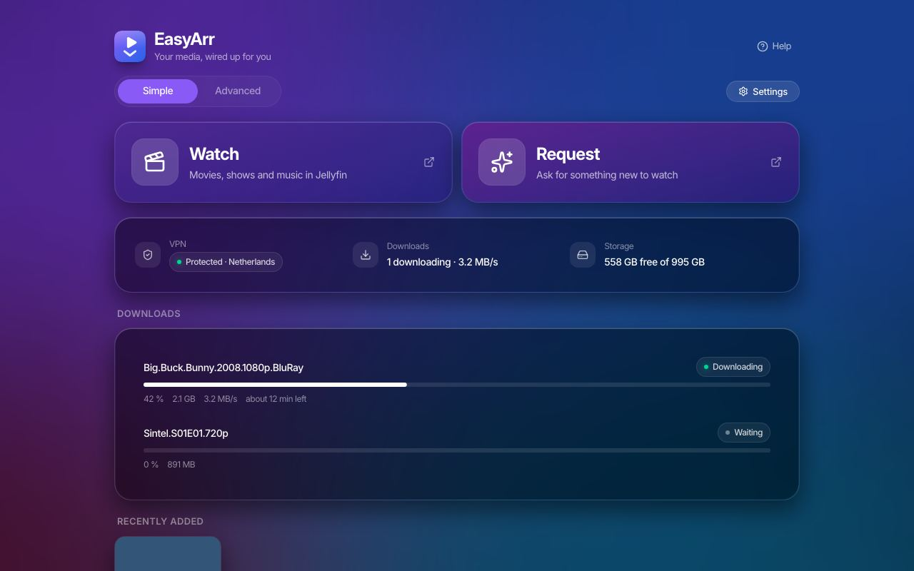

# EasyArr

**Your own streaming service on your Umbrel, set up for you.**

EasyArr is a free app for [Umbrel](https://umbrel.com) home servers. You ask for a movie, a show or
an album. EasyArr finds it, downloads it through a VPN, sorts it and makes it ready to watch on your
TV, phone or browser. It installs and connects a complete media setup (Jellyfin, Jellyseerr, Sonarr,
Radarr, Lidarr, Prowlarr, qBittorrent, SABnzbd, Bazarr and more) and asks you a few plain questions
instead of making you configure a dozen apps.

No terminal, no config files, no API keys to copy around.

> EasyArr is new. Versions before 0.1.0 are test versions, so expect rough edges and
> [tell us](https://github.com/w1kyu/easyarr/issues) what you find.

## What it does

- **A guided setup** that takes about 10 minutes. It checks your Umbrel, creates your account,
  connects your VPN and wires every app to the others. Every page explains itself.
- **Downloads only through a VPN**, with a kill switch: if the VPN drops, downloads stop instead of
  using your home connection. Step-by-step guides for Proton VPN, PIA, AirVPN, Mullvad, NordVPN,
  Surfshark and others.
- **Torrents, Usenet or both.** EasyArr explains the difference and sets up qBittorrent and/or
  SABnzbd for you.
- **Your languages and quality.** Choose the audio and subtitle languages you want and how much disk
  space to use. Sonarr, Radarr, Bazarr and Jellyfin follow your choice.
- **A home screen that explains problems** in plain words, such as "only available in English so
  far", with a button to fix them.
- **Settings, backups and restore** from one place, including automatic backups.
- **Help built in:** every guide is inside the app, and **Get help with AI** writes a question about
  your setup for ChatGPT, Claude or Gemini, with your passwords and keys removed.

## Install in 3 steps

1. On your Umbrel, open the **App Store**, click **⋯** at the top right, then **Community App
   Stores**. Paste `https://github.com/w1kyu/umbrel-app-store` and click **Add**.
2. Open the **w1kyu Apps** store and install **EasyArr**.
3. Open EasyArr from your Umbrel's home screen and follow the setup.

The full walk-through with screenshots: [Getting started](docs/getting-started.md).

## What you need

- **An Umbrel**, on an Intel/AMD computer (amd64) or an ARM board like the Raspberry Pi 5 (arm64).
  EasyArr is tested on umbrelOS 2.0. 8 GB of memory or more is recommended, and a graphics chip
  (like Intel Quick Sync) helps Jellyfin play videos on every device. See
  [System requirements](docs/system-requirements.md).
- **Disk space** for your movies and shows. A movie is often 2–10 GB.
- **A VPN subscription.** EasyArr won't download without one. See [VPN basics](docs/vpn/README.md)
  for how to choose one.
- **For Usenet only:** a Usenet provider and an indexer account.

## Documentation

| Start here | Everyday use | Help |
| ---------- | ------------ | ---- |
| [Getting started](docs/getting-started.md) | [Family accounts](docs/family-accounts.md) | [Troubleshooting](docs/troubleshooting.md) |
| [How EasyArr works](docs/how-it-works.md) | [Watch away from home](docs/remote-access-tailscale.md) | [FAQ](docs/faq.md) |
| [Torrents 101](docs/torrents-101.md) · [Usenet 101](docs/usenet-101.md) | [Backups](docs/backup-restore.md) | [Getting help](docs/getting-help.md) |
| [VPN guides](docs/vpn/README.md) | [Quality presets](docs/quality-presets.md) | [Search sites](docs/indexers.md) |

All guides are also inside EasyArr under **Help**. For AI assistants, every guide is collected in
[llms.txt](llms.txt).

## Please use it responsibly

EasyArr is a tool. Only download content you have the right to download and share. Laws differ
between countries, and you are responsible for following the laws where you live.

## Credits

EasyArr stands on the shoulders of these open-source projects. Each one keeps its own license and
runs as its own container:

| Project | What it does in EasyArr | License |
| ------- | ----------------------- | ------- |
| [Jellyfin](https://github.com/jellyfin/jellyfin) | Watch movies, shows and music | GPL-2.0 |
| [Seerr](https://github.com/seerr-team/seerr) (Jellyseerr) | Request page | MIT |
| [Sonarr](https://github.com/Sonarr/Sonarr) | TV shows | GPL-3.0 |
| [Radarr](https://github.com/Radarr/Radarr) | Movies | GPL-3.0 |
| [Lidarr](https://github.com/Lidarr/Lidarr) | Music | GPL-3.0 |
| [Prowlarr](https://github.com/Prowlarr/Prowlarr) | Search sites | GPL-3.0 |
| [qBittorrent](https://github.com/qbittorrent/qBittorrent) | Torrent downloads | GPL-2.0-or-later |
| [SABnzbd](https://github.com/sabnzbd/sabnzbd) | Usenet downloads | GPL-2.0-or-later |
| [Bazarr](https://github.com/morpheus65535/bazarr) | Subtitles | GPL-3.0 |
| [Recyclarr](https://github.com/recyclarr/recyclarr) | Quality settings from the [TRaSH Guides](https://trash-guides.info) | MIT |
| [Unpackerr](https://github.com/Unpackerr/unpackerr) | Unpacks downloads | MIT |
| [Cleanuparr](https://github.com/Cleanuparr/Cleanuparr) | Removes stuck downloads | GPL-3.0 |
| [FlareSolverr](https://github.com/FlareSolverr/FlareSolverr) | Helps with protected search sites | MIT |
| [Gluetun](https://github.com/qdm12/gluetun) | VPN with kill switch | MIT |

Many images come from [LinuxServer.io](https://www.linuxserver.io). The dashboard's look is based
on [umbrelOS](https://github.com/getumbrel/umbrel)'s own interface.

## Contributing

Bug reports, outdated VPN guides and fixes are welcome. See [CONTRIBUTING.md](CONTRIBUTING.md) and
the developer docs: [architecture](docs/dev/architecture.md), [development](docs/dev/development.md),
[releases](docs/dev/release.md). Found a security problem? See [SECURITY.md](SECURITY.md).

## License

EasyArr's own code is MIT. It includes code from umbrelOS under PolyForm Noncommercial 1.0.0, so
EasyArr as a whole may only be used for **noncommercial** purposes. See [NOTICE.md](NOTICE.md) and
[LICENSE](LICENSE).

EasyArr is an independent project and is not affiliated with or endorsed by Umbrel.
