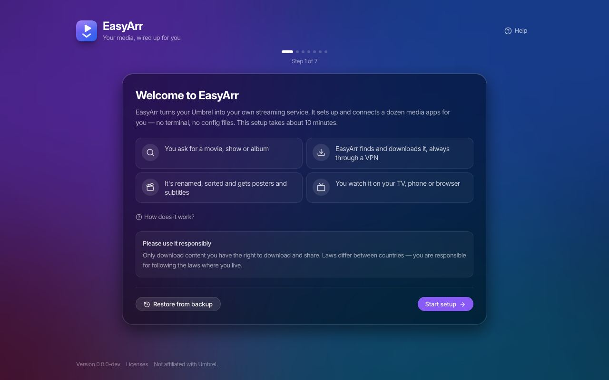
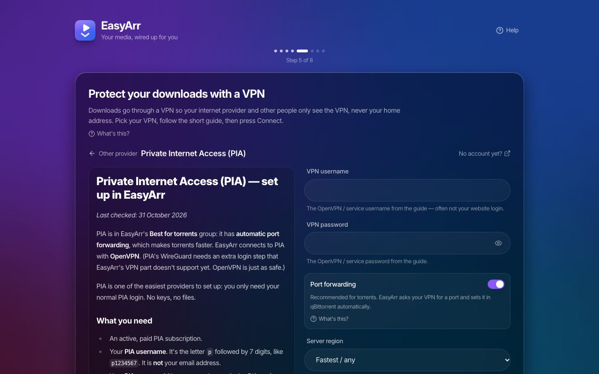
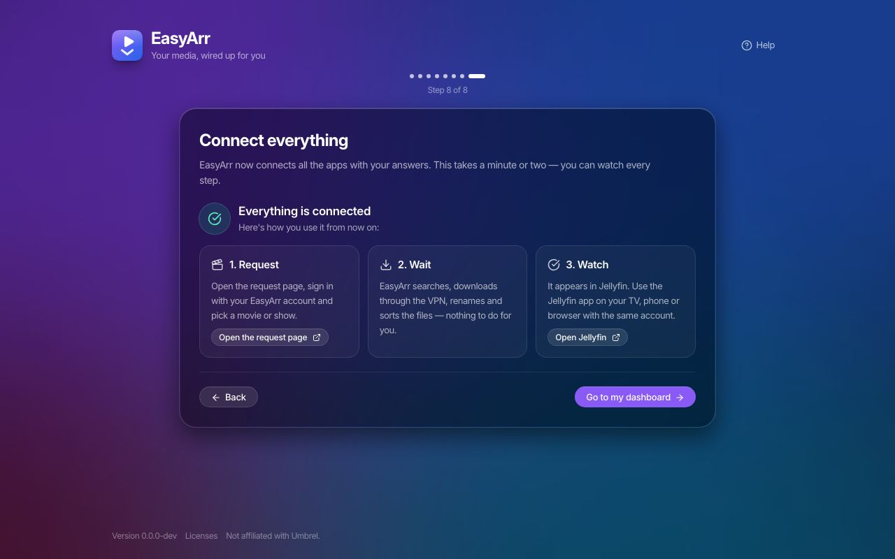
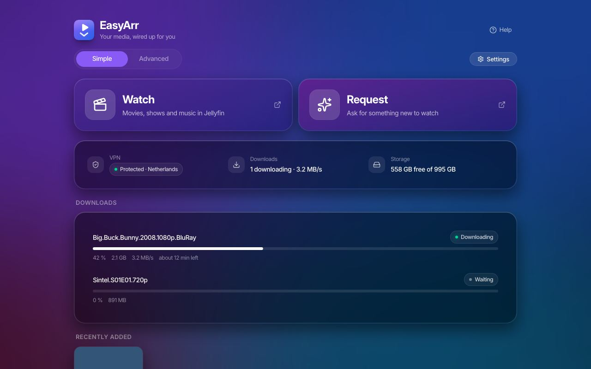

# Getting started

This guide takes you from "nothing installed" to "watching your first movie". It takes about
20 minutes, plus the time your first download needs.

> **What you'll need**
>
> - An Umbrel. EasyArr is tested on umbrelOS 2.0. 8 GB of memory or more is best, see
>   [System requirements](system-requirements.md).
> - Free disk space for your movies and shows. A movie is often 2–10 GB.
> - A **VPN** subscription. EasyArr only downloads through a VPN. The [VPN guide](vpn/README.md)
>   helps you pick one. You can also skip it and add it later, but nothing downloads until then.
> - For **Usenet** only: an account with a Usenet provider and one with an indexer, see
>   [Usenet explained](usenet-101.md). For torrents you don't need any other account.

## 1. Add the w1kyu Apps store to your Umbrel

EasyArr isn't in Umbrel's own App Store. It comes from a "community app store" that you add once.

1. Open your Umbrel in the browser, for example `http://umbrel.local`.
2. Open the **App Store**.
3. Click the **⋯** button at the top right.
4. Click **Community App Stores**.
5. Paste this address: `https://github.com/w1kyu/umbrel-app-store`
6. Click **Add**.

The store is now listed as **w1kyu Apps**. Community stores aren't checked by Umbrel. EasyArr is
open source, so anyone can read its code on [GitHub](https://github.com/w1kyu/easyarr).

## 2. Install EasyArr

1. Open the **w1kyu Apps** store.
2. Click **EasyArr**, then **Install**.
3. Wait until the EasyArr icon appears on your Umbrel's home screen. The first install downloads
   about a dozen apps, so it can take 5–15 minutes.
4. Click the **EasyArr** icon. The setup starts.

## 3. Go through the setup

The setup asks a few questions, one per page. Every page has a **What's this?** link if you want to
know more. You can go back at any time, and you can change every answer later in **Settings**.

1. **Welcome.** Press **Start setup**. Already used EasyArr before? Press **Restore from backup**
   instead, see [Backups](backup-restore.md).
2. **Checking your Umbrel.** EasyArr looks at your processor, memory, disk and graphics chip. A
   yellow or red result is explained on the page. See [System requirements](system-requirements.md).
3. **Create your account.** Choose a username and password. You use them to watch in Jellyfin and
   to request things. Family members get their own accounts later, see
   [Family accounts](family-accounts.md).
4. **How do you want to download?** Pick **Torrents**, **Usenet** or **Both**. Not sure? Start with
   torrents. [Torrents 101](torrents-101.md) and [Usenet 101](usenet-101.md) explain the difference.
5. **Protect your downloads with a VPN.** Pick your VPN provider. A short guide for that provider
   opens next to the form: follow it, fill in the fields, then press **Connect**. EasyArr tests the
   connection and checks that your home address is hidden.

   

6. **Your Usenet accounts** (only for Usenet). Enter your provider and your indexer. EasyArr tests
   both for you.
7. **Add search sites for torrents** (only for torrents). Open Prowlarr from this page and add one
   or more search sites, following [Search sites](indexers.md). EasyArr notices them by itself.
8. **What do you want?** Choose movies, shows and/or music, your languages and a quality. The
   default (**Balanced**) suits most people, see [Quality presets](quality-presets.md).
9. **Connect everything.** Press **Connect everything**. EasyArr now sets up every app with your
   answers and shows each step as it goes. This takes a minute or two.

When it's done, you see a short "what now" tour. Press **Go to my dashboard**.

## 4. Ask for your first movie

1. On the EasyArr home screen, press **Request**. The request page (Jellyseerr) opens in a new tab.
2. Sign in with the username and password from step 3 of the setup.
3. Search for a movie and press **Request**.

That's all. EasyArr searches your sites, downloads through the VPN, renames the file and puts it in
your library. You can follow the download on the EasyArr home screen, under **Downloads**.

How long it takes depends on the file size, your internet speed and, for torrents, how many people
share the file. Something seems stuck? The home screen tells you why under **Needs your attention**.

## 5. Watch it

1. On the EasyArr home screen, press **Watch**. Jellyfin opens.
2. Sign in with the same username and password.
3. Your movie is under **Movies** once it's downloaded.

On a TV, phone or tablet, install the free **Jellyfin** app from your device's app store. When it
asks for a server, enter `http://umbrel.local:39096`. If that doesn't work, use your Umbrel's IP
address instead, for example `http://192.168.1.20:39096`. Your router's list of connected devices
shows the Umbrel's IP address.

## What next?

- Give your family their own accounts: [Family accounts](family-accounts.md).
- Watch when you're away from home: [Remote access with Tailscale](remote-access-tailscale.md).
- Turn on automatic backups: [Backups](backup-restore.md).
- Something doesn't work? [Troubleshooting](troubleshooting.md) and [Getting help](getting-help.md).
