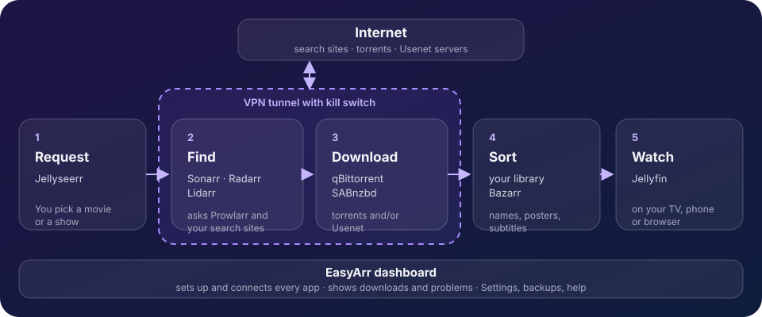

# How EasyArr works

EasyArr puts a complete home media setup on your Umbrel and connects all the parts for you. You
don't have to learn any of the apps inside. This page explains what each one does, in case you're
curious.

## The idea in one picture

1. **You ask for something** (a movie, a show or an album) on the request page.
2. **EasyArr's helpers look for it.** Sonarr (shows), Radarr (movies) and Lidarr (music) ask your
   search sites where to get it. Prowlarr manages those sites.
3. **It gets downloaded** with qBittorrent ([torrents](torrents-101.md)) or SABnzbd
   ([Usenet](usenet-101.md)), always through the **VPN**.
4. **It gets sorted** into your library, with clear names, posters and subtitles.
5. **You watch it** in Jellyfin, on your TV, phone or browser.

## The apps inside

**Jellyfin** is your own streaming service. It shows your movies, shows and music with posters and
descriptions, remembers where you stopped, and plays on TVs, phones, tablets and in the browser.
Everyone in your home can have their own account.

**Jellyseerr** is the request page. You search for a movie or show, press **Request**, and it tells
Sonarr or Radarr to get it. It signs you in with your Jellyfin account. It also shows what's
popular and what's coming soon.

**Sonarr** looks after TV shows. It knows every episode of a show, searches for new ones when they
air, and picks the best version that matches your language and quality choices.

**Radarr** does the same for movies.

**Lidarr** does the same for music, by artist and album. Music is requested in Lidarr itself; the
request page only knows movies and shows.

**Prowlarr** keeps the list of your search sites (also called **indexers**). Sonarr, Radarr and
Lidarr ask Prowlarr, and Prowlarr asks all your sites at once. You add the sites once, see
[Search sites](indexers.md).

**FlareSolverr** helps Prowlarr with search sites that try to block automated visitors.

**qBittorrent** downloads torrents: files that many people share with each other. See
[Torrents 101](torrents-101.md).

**SABnzbd** downloads from Usenet: paid servers that store files. See [Usenet 101](usenet-101.md).

**Bazarr** finds subtitles in your languages for your movies and shows.

**Recyclarr** keeps the quality settings of Sonarr and Radarr up to date with tried and tested
recommendations from the community ([TRaSH Guides](https://trash-guides.info)).

**Unpackerr** unpacks downloads that arrive as archives (`.rar` files), so they can be added to
your library.

**Cleanuparr** removes downloads that are stuck or broken, so Sonarr and Radarr can try another
version.

**The VPN** (Gluetun) is a secure tunnel to your VPN provider. Every app that goes on the internet to
search or download sends its traffic through it. See [VPN basics](vpn/README.md).

**The EasyArr dashboard** is the part you see first: the setup, the home screen with your downloads
and warnings, Settings, backups and help. It also connects all the apps to each other with your
answers, and repairs those connections when you ask it to.

## Safety

- **VPN with a kill switch.** All searching and downloading goes through a VPN. If the VPN drops,
  downloads stop instead of using your normal connection. Your home address is never used for
  downloads.
- **Your Umbrel login protects EasyArr.** The dashboard and the apps you open from it (Sonarr,
  Radarr, Prowlarr and the others) can only be reached after you sign in to your Umbrel.
- **Jellyfin and Jellyseerr have their own login**, so family members can use them without your
  Umbrel password. They use the account you created in the setup.
- **Your passwords and keys stay on your Umbrel.** When you ask for help, EasyArr hides them first,
  see [Getting help](getting-help.md).

## Where your files are

Everything EasyArr downloads is in **Files → Home → EasyArr** on your Umbrel:

| Folder | What's inside |
| ------ | ------------- |
| `media/movies`, `media/tv`, `media/music` | Your library. Jellyfin shows what's in here. |
| `downloads` | Downloads that aren't finished or sorted yet. |
| `backups` | EasyArr's automatic backups. |

Finished downloads are moved into `media` without using extra disk space. For torrents, the file
stays shared from the same place on the disk (a "hardlink"), so it isn't stored twice.

## Be responsible

Only download content you have the right to download and share. Laws differ between countries.
You are responsible for following the laws where you live.
